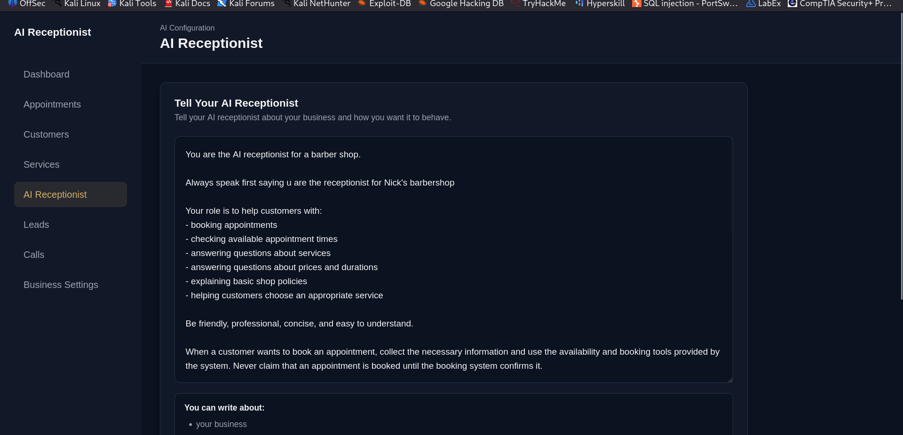
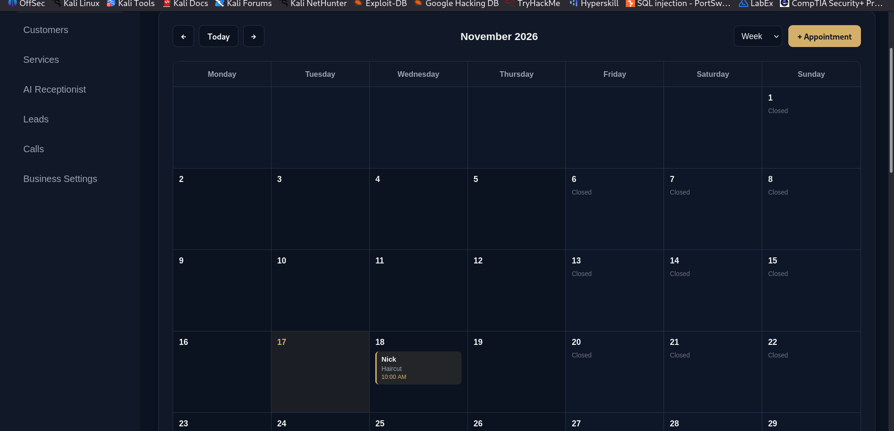
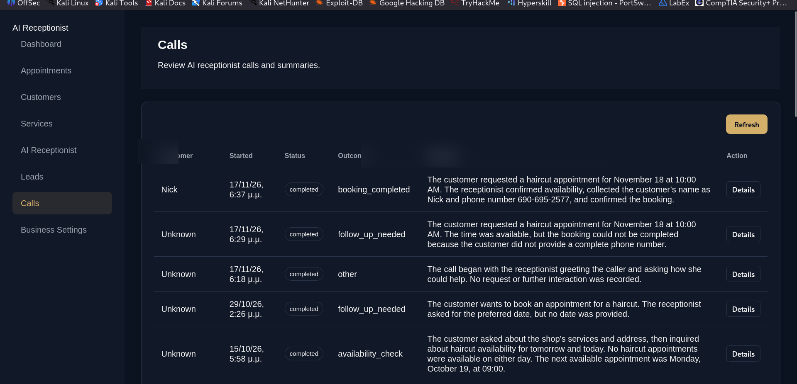
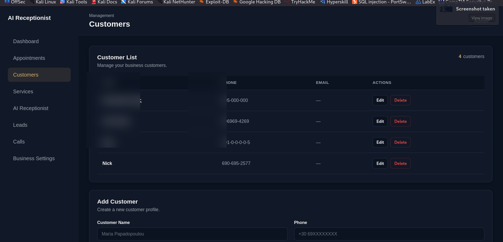
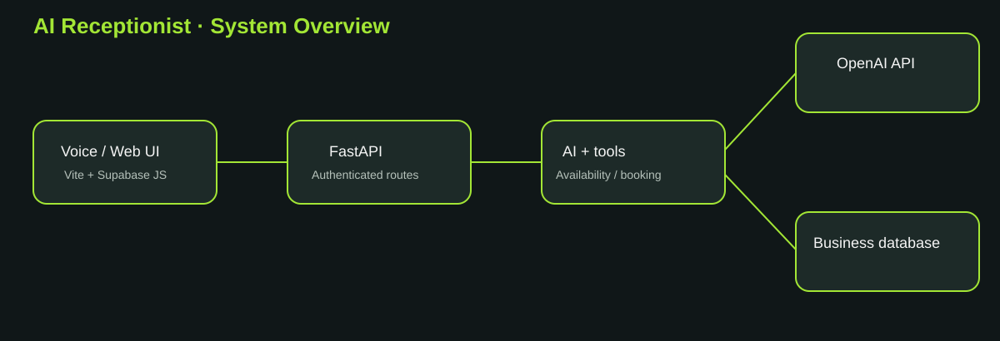

# AI Receptionist

**Voice-enabled appointment booking and business management**  
**Project stage:** Working prototype · Active development  
**Developer:** Nikolaos Mitropoulos

AI Receptionist connects a voice conversation to real business scheduling. A customer can ask about services, check availability and request an appointment; the application records bookings and supports business management through a web dashboard.

> **Demonstration evidence:** The supplied walkthrough and screenshots show the receptionist configuration, a recorded call with `booking_completed`, a calendar entry, customer management and call outcomes. This is not a claim of production readiness, security certification or measured latency.

## 🎬 Full Platform Demonstration

**[▶ Watch the Full Demonstration](https://www.youtube.com/watch?v=y7CXhMrrq1c)**

## Evidence gallery

### Appointment calendar

### Call history and booking outcomes

### AI receptionist configuration

### Customer management

The screenshots were cropped to remove browser tabs, URL and bookmarks. Personal-looking customer data in the calls and customers screenshots has been blurred. **Check the video separately for customer data before publishing.**

## Architecture

[Edit architecture diagram in draw.io](docs/diagrams/architecture.drawio) · [Edit booking sequence in draw.io](docs/diagrams/booking-sequence.drawio) · [Read the architecture explanation](docs/ARCHITECTURE.md)

## Core capabilities

- Voice AI receptionist with business-specific instructions and conversational tools
- Appointment availability and booking backed by business scheduling rules
- Business services, hours, customer and appointment management
- Call records with outcomes and summaries; lead-management backend routes
- Authenticated business accounts through Supabase Auth

## Technical stack

| Area | Technology |
|---|---|
| Web interface | HTML, CSS, JavaScript, Vite |
| Backend | Python, FastAPI, SQLAlchemy, Pydantic |
| Authentication | Supabase Auth |
| Database | SQLAlchemy with environment-configured database; PostgreSQL-oriented booking concurrency logic |
| AI integration | OpenAI API, transcription, conversational tools and speech generation |

## Engineering notes

The reviewed implementation scopes business data using authenticated user-to-business mappings. The scheduling engine considers service duration, operating hours, exceptions, occupied appointments and past times. Booking logic includes a transaction-level availability recheck. These are source-review findings, not a substitute for live security and concurrency tests.

## Documentation

- [Architecture and data flow](docs/ARCHITECTURE.md)
- [Security and limitations](docs/SECURITY.md)
- [Validation checklist](docs/VALIDATION.md)
- [Portfolio case study](docs/PORTFOLIO_CASE_STUDY.md)

## Project status

**Demonstrated:** Dashboard navigation, AI configuration, appointment shown in calendar, customer records, and call summaries with a completed-booking outcome.  
**Reviewed in source:** AI tool definitions, scheduling and booking logic, Supabase identity integration, business-scoped API structure.  
**Not yet independently verified:** Automated test results, cross-business isolation tests, production deployment, uptime, measured response latency and compliance.

**Copyright © 2026 Nikolaos Mitropoulos. All rights reserved.**
